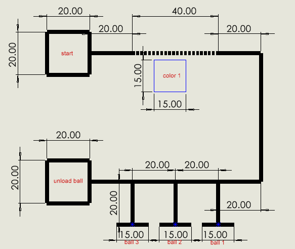

# AIROST Dual-Mode Autonomous Delivery Robot (Bare-Metal STM32F756ZG)

A dual-mode autonomous + Bluetooth-teleoperated delivery robot built for the **AIROST 26/27 IoT / ROS Challenge (Problem 1)** using **direct CMSIS register-level C programming** on the **STM32 NUCLEO-F756ZG** (ARM Cortex-M7).

---

## Key Engineering Highlights

* **100% Bare-Metal Register-Level C:** Direct control of `RCC`, `GPIOx`, `ADC1`, `DMA2_Stream0`, `TIM1–TIM4`, `TIM6`, `I2C1`, `USART2`, and the Cortex-M7 hardware `FPU`.
* **100 Hz Two-Stage Cascaded PID Control:**
  * **Outer Loop:** 5-channel IR weighted-centroid line PID (`ADC1` + `DMA2_Stream0` circular scan), automatically switching to **`MPU-6050` Z-axis gyro heading hold** across the 40 cm dashed-line white gaps.
  * **Inner Loop:** Dual hardware quadrature encoder speed PIDs (`TIM3` Left, `TIM4` Right) with velocity feedforward driving a `TB6612FNG` dual H-bridge at 20 kHz (`TIM1`).
* **Dynamic `I2C1` Address Multiplexing (No External Mux Needed):** Sequential `XSHUT` boot release (`PG0–PG2`) reassigns three `VL53LXX-V2` laser ToF modules from default `0x29` to `0x30` (Front), `0x31` (Left), and `0x32` (Right), leaving `0x29` conflict-free for the `TCS34725` RGB colour station sensor and `0x68` for the `MPU-6050` IMU.
* **Autonomous-to-Manual Handoff:** Detects colour station tiles (**Red = Ball 1**, **Blue = Ball 2**, **Green = Ball 3**), executes a closed-loop 90° gyro+encoder PID turn into the target station branch, and hands over control to `ZS-040` (HC-05/06) Bluetooth UART (`USART2`) to pick up and deliver a 40 mm ping-pong ball.
* **Hardware & Power Hub:** Soldered donut board (perfboard) providing `3.3 V`, `5 V`, star `Common GND`, and shared `I2C1` bus headers for two 25 mm metal cylinder encoder gearmotors, passive low-friction rear TT support wheel, `TB6612FNG`, and sensors.

---

## Course Reference



---

## Repository Structure

```text
Airost_delivery_robot/
├── firmware/
│   └── Core/
│       ├── Inc/
│       │   ├── bluetooth.h       # ZS-040 (HC-05/06) Bluetooth USART2 API
│       │   ├── color_sensor.h    # TCS34725 RGB station classifier API
│       │   ├── i2c_bus.h         # Shared 100 kHz I2C1 & exact TIM6 delay API
│       │   ├── line_sensor.h     # 5-ch IR array ADC1 + DMA2_Stream0 API
│       │   ├── motor_mpu.h       # TB6612FNG, TIM3/TIM4 encoders, servos, MPU-6050 & PID
│       │   └── tof.h             # 3x VL53LXX-V2 ToF XSHUT + ranging API
│       └── Src/
│           ├── main.c            # 100 Hz state machine & cascaded PID combination logic
│           ├── bluetooth.c
│           ├── color_sensor.c
│           ├── i2c_bus.c
│           ├── line_sensor.c
│           ├── motor_mpu.c
│           └── tof.c
├── docs/
│   ├── AIROST_Final_Project_Documentation.docx
│   ├── Robot_Parts_List.md
│   └── images/
│       ├── airost_course_standard.png
│       └── airost_course_advanced.png
├── .gitignore
└── README.md
```

---

## Master Hardware Pinout (`STM32 NUCLEO-F756ZG`)

> **Power Rule:** Connect all logic sensors (`5-ch IR`, `TCS34725`, `3× VL53LXX-V2`, `MPU-6050`), `TB6612FNG VCC`, and both **Motor Hall Encoder `VCC` wires** to **`3.3V`** (`CN8 Pin 7`). Connect `ZS-040 VCC` and Servos `V+` to **`5V`**, `TB6612FNG VM` to **Battery `+`**, and tie **all `GND` lines together**.

| Subsystem | Module Pin | `NUCLEO-F756ZG` Pin | Header Position | STM32 Peripheral |
| :--- | :--- | :--- | :--- | :--- |
| **5-Ch Line Array** | `OUT1..OUT3` | `PA3`, `PC0`, `PC3` | `CN9` **`A0`**, **`A1`**, **`A2`** | `ADC1_IN3/10/13` + `DMA2_S0` |
| **5-Ch Line Array** | `OUT4`, `OUT5` | `PA4`, `PA5` | `CN7 Pin 17`, **`D13`** | `ADC1_IN4/5` + `DMA2_S0` |
| **`TB6612FNG` Driver** | `PWMA`, `PWMB` | `PE9`, `PE11` | `CN10` **`D6`**, **`D5`** | `TIM1_CH1`, `TIM1_CH2` (20 kHz) |
| **`TB6612FNG` Driver** | `AIN1`, `AIN2` | `PF13`, `PE13` | `CN10` **`D7`**, **`D3`** | `GPIOF`, `GPIOE` Output |
| **`TB6612FNG` Driver** | `BIN1`, `BIN2` | `PF14`, `PF15` | `CN10` **`D4`**, **`D2`** | `GPIOF` Output |
| **`TB6612FNG` Driver** | `STBY` | `3.3V` *(or `PE10`)* | `CN8 Pin 7` *(or `CN10 Pin 24`)* | Driven `HIGH` |
| **Left Encoder** | `C1 (A)`, `C2 (B)` | `PA6`, `PC7` | `CN7` **`D12`**, `CN7 Pin 11` | `TIM3_CH1`, `TIM3_CH2` (`AF2`) |
| **Right Encoder** | `C1 (A)`, `C2 (B)` | `PD12`, `PD13` | `CN10 Pin 21`, `CN10 Pin 19` | `TIM4_CH1`, `TIM4_CH2` (`AF2`) |
| **Ball Servos** | `Lift`, `Claw` | `PB10`, `PB11` | `CN10 Pin 32`, `CN10 Pin 34` | `TIM2_CH3`, `TIM2_CH4` (50 Hz) |
| **`ZS-040` Bluetooth** | `RXD`, `TXD` | `PD5 (TX)`, `PD6 (RX)` | `CN9 Pin 6`, `CN9 Pin 4` | `USART2` (`AF7`, 9600 baud) |
| **Shared `I2C1` Bus** | `SCL`, `SDA` | `PB8`, `PB9` | `CN7` **`D15/SCL`**, **`D14/SDA`** | `I2C1` (`AF4`, 100 kHz) |
| **3× `VL53LXX-V2`** | `XSHUT` (F, L, R) | `PG0`, `PG1`, `PG2` | `CN9 Pin 29/30`, `CN8 Pin 14` | `GPIOG` (`0x30`, `0x31`, `0x32`) |

---

## How to Build & Flash in STM32CubeIDE

1. Open **STM32CubeIDE** $\rightarrow$ **File $\rightarrow$ New $\rightarrow$ STM32 Project** $\rightarrow$ select **`NUCLEO-F756ZG`** (choose **No** when prompted to initialize default peripherals so HAL does not conflict with bare-metal registers).
2. Copy all **6 `.h` files** from `firmware/Core/Inc/` into `Core/Inc/` and all **7 `.c` files** from `firmware/Core/Src/` into `Core/Src/` (overwriting `main.c`).
3. Click **Build (`Ctrl + B`)** — verifies cleanly with **`0 errors, 0 warnings`** (`~15 KB` Flash, `~1.8 KB` RAM).
4. Connect the `NUCLEO-F756ZG` via the top **`CN1` (`ST-LINK`)** micro-USB port and click **Run / Debug (`F11`)**.
5. In Debug mode, add `line_adc_raw`, `drive_pid`, `tof_data`, `color_data`, `imu_data`, and `robot_state` to **Live Expressions**.

---

## Quick Calibration & Bluetooth Controls

* **IR Line Polarity:** In `firmware/Core/Inc/line_sensor.h`, `#define LINE_BLACK_IS_HIGH 1` assumes black tape gives a higher ADC reading than white floor. If your 5-channel sensor gives a **lower** ADC reading on black tape (e.g., TCRT5000 / BFD-1000), change it to `0`.
* **Bluetooth Serial Commands (`9600` baud, 8N1):**
  * `M` / `T` : Switch to **Manual Bluetooth Mode** (`M`) or **Autonomous Line-Following Mode** (`T`)
  * `F` / `B` / `L` / `R` / `0` : Forward, Backward, Spin Left, Spin Right, Stop (encoder speed-PID regulated)
  * `J` / `U` : Lower (`J`) or Lift (`U`) front pickup arm
  * `G` / `O` : Grab/Close (`G`) or Open/Release (`O`) ball gripper claw
